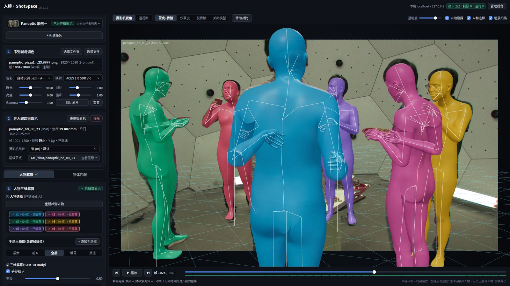
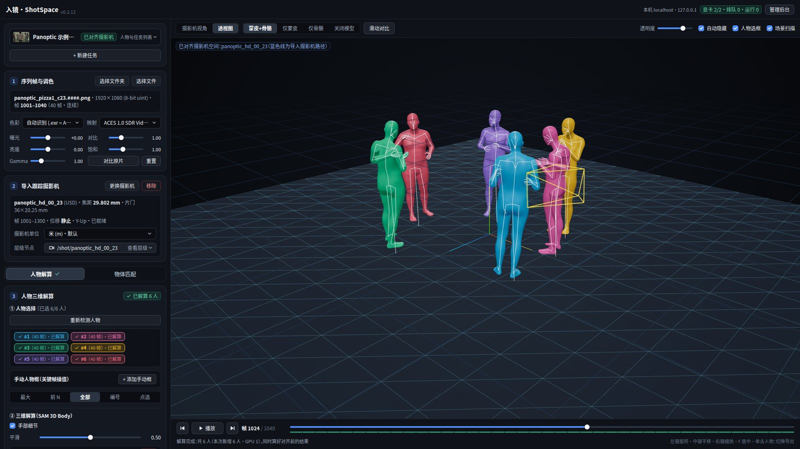

<div align="center">

# ShotSpace · 入镜

**Put the people of a live-action shot into the 3D space of its tracked camera**

[](LICENSE)


[](https://github.com/facebookresearch/sam3)
[](https://github.com/facebookresearch/sam-3d-body)

[简体中文](README.md) | **English**



</div>

## Overview

ShotSpace is a body-matchmove tool for film and TV. It brings open models from Meta, SAM 3.1 and SAM 3D Body among them, into a VFX pipeline: given an undistorted image sequence, the camera your matchmove already tracked and, optionally, a scan of the set, it delivers 3D people aligned with the shot's camera space.

Finding, tracking and per-frame 3D estimation of people are done by these models; ShotSpace places their results in the exact camera space, solves each person over the whole shot and writes the usual VFX deliverables.

- Uses the tracked camera's per-frame intrinsics and extrinsics as they are
- Whole-shot solve, with ground constraints when a scan is available
- Several people per shot, solved one by one or together
- Exports USD skeleton, USD point cache, FBX and Alembic
- Web interface; several computers share one GPU server



## Requirements

| | |
|---|---|
| OS | Linux x86_64 (glibc ≥ 2.28) or Windows 10 / 11 x64 |
| GPU | NVIDIA, about 24 GB, driver ≥ 570 |
| Disk | about 30 GB (about 75 GB with object matching) |
| Browser | Chrome |

## Install

```bash
git clone https://github.com/vfxli/ShotSpace.git
cd ShotSpace
./setup.sh        # Linux
setup.bat         # Windows
```

The setup wizard asks for download sources, components and where the models come from, then installs everything
inside this folder without touching the system. To uninstall, delete the folder.

- **Mirrors**: PyPI, PyTorch, Python, source code and models each have several sources; the fastest is picked, failures fall back, downloads resume, and every file is checked by SHA-256.
- **Model weights**: from [ModelScope](https://modelscope.cn) (no account), HuggingFace (request access to [SAM 3D Body](https://huggingface.co/facebook/sam-3d-body-dinov3) and [SAM 3.1](https://huggingface.co/facebook/sam3.1)), or a local folder.
- **Unattended**: `./setup.sh --yes --region global --weights huggingface`

## Usage

```bash
./shotspace.sh start      # Windows: shotspace.bat start
```

Open `http://<server>:8765` in Chrome; the admin page is `/admin`.

1. Create a task, load the image sequence and grade it
2. Load the tracked camera (`.abc` / `.fbx` / `.usd`)
3. Pick people and solve
4. Optional: load a set scan and align to it
5. Export USD / FBX / ABC

## Built on

ShotSpace stands on the shoulders of these projects; thanks to their authors:

| Project | Used for |
|---|---|
| [SAM 3 / SAM 3.1](https://github.com/facebookresearch/sam3) (Meta) | finding and tracking people |
| [SAM 3D Body](https://github.com/facebookresearch/sam-3d-body) (Meta) | per-frame body pose and shape, with the MHR body model |
| [DINOv3](https://github.com/facebookresearch/dinov3) (Meta) | image backbone of SAM 3D Body |
| [SAM 3D Objects](https://github.com/facebookresearch/sam-3d-objects), [MoGe](https://github.com/microsoft/MoGe), [TripoSR](https://github.com/VAST-AI-Research/TripoSR) | object matching (optional) |
| [PyTorch](https://pytorch.org), [OpenUSD](https://openusd.org), [Alembic](https://github.com/alembic/alembic), Autodesk FBX SDK, [OpenColorIO](https://opencolorio.org), [OpenImageIO](https://github.com/AcademySoftwareFoundation/OpenImageIO) | compute, colour and file formats |

ShotSpace's own part: the whole-shot solve that places the model results in the tracked camera space (`shotspace/solver/`), the web interface and job queue, and the VFX format import/export.

## License

ShotSpace is released under the [MIT License](LICENSE). The models downloaded at setup keep their own licences (SAM
License, DINOv3 License, ...); see [THIRD_PARTY_NOTICES.md](THIRD_PARTY_NOTICES.md).
