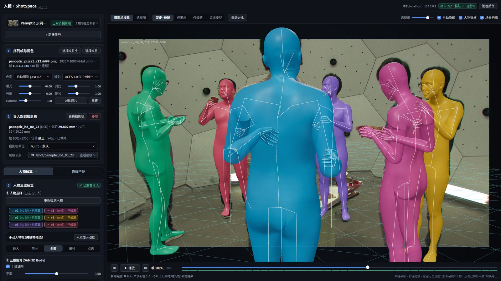
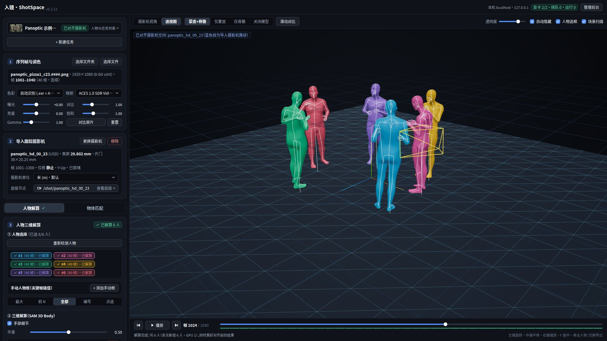

<div align="center">

# 入镜 · ShotSpace

**把实拍镜头里的人，解算到跟踪摄影机的三维空间中**

[](LICENSE)


**简体中文** | [English](README.en.md)



</div>

## 简介

输入去畸变序列、已跟踪好的摄影机和（可选）场景扫描，入镜自动找到画面中的每个人，逐帧估计身体，再对整段镜头统一解算，输出与原镜头空间完全对齐的三维人物。

- **精确对位**：直接使用跟踪摄影机的逐帧内外参，不反求、不改动。
- **整段解算**：每人一套固定体型，位置由每帧画面和摄影机共同约束；有扫描时人站在真实地面上。
- **多人与人群**：SAM 3.1 跟踪全部人物，SAM 3D Body 逐帧估计，可逐个累加解算。
- **标准交付**：USD 骨架、USD 点缓存、FBX、Alembic，单位米。
- **团队使用**：一台显卡服务器，大家用 Chrome 访问；每台电脑只看到自己的任务，管理后台统一管理。



## 环境要求

| | |
|---|---|
| 系统 | Linux x86_64（glibc ≥ 2.28）或 Windows 10 / 11 x64 |
| 显卡 | NVIDIA，约 24 GB 显存，驱动 ≥ 570 |
| 磁盘 | 约 30 GB（含物体匹配约 75 GB） |
| 浏览器 | Chrome |

## 安装

```bash
git clone https://github.com/vfxli/ShotSpace.git
cd ShotSpace
./setup.sh        # Linux
setup.bat         # Windows
```

安装向导会依次询问下载源、安装内容和模型来源，所有内容装在本文件夹内，不修改系统环境；卸载即删除文件夹。

- **多镜像源**：PyPI、PyTorch、Python、源码、模型均有国内外多个下载源，自动测速、失败切换、断点续传，全部按 SHA-256 校验。
- **模型权重**：默认从 [ModelScope](https://modelscope.cn) 下载（无需账号）；也可选 HuggingFace（需申请 [SAM 3D Body](https://huggingface.co/facebook/sam-3d-body-dinov3) 与 [SAM 3.1](https://huggingface.co/facebook/sam3.1) 访问权限）或本地文件夹。
- **静默安装**：`./setup.sh --yes --region cn --weights modelscope`

## 使用

```bash
./shotspace.sh start      # Windows: shotspace.bat start
```

浏览器打开 `http://<服务器地址>:8765`，管理后台为 `/admin`。

1. 新建任务，导入序列图并调色
2. 导入跟踪摄影机（`.abc` / `.fbx` / `.usd`）
3. 选择人物，解算
4. 可选：导入场景扫描，按扫描对齐
5. 导出 USD / FBX / ABC

## 工作原理

| 阶段 | 方法 | 代码 |
|---|---|---|
| 找人与跟踪 | SAM 3.1 正反双向跟踪，每人每帧一张遮罩 | `solver/workers/people_tracker.py` |
| 逐帧估计 | SAM 3D Body，使用摄影机真实内参 | `solver/workers/sam3d_worker.py` |
| 整段解算 | 固定体型 + 摄影机约束 + 地面约束 | `solver/trajectory.py` · `solver/workers/body_solve.py` |

## 许可

本项目以 [MIT](LICENSE) 许可开源。安装时下载的模型遵循各自许可（SAM License、DINOv3 License 等），详见 [THIRD_PARTY_NOTICES.md](THIRD_PARTY_NOTICES.md)。
